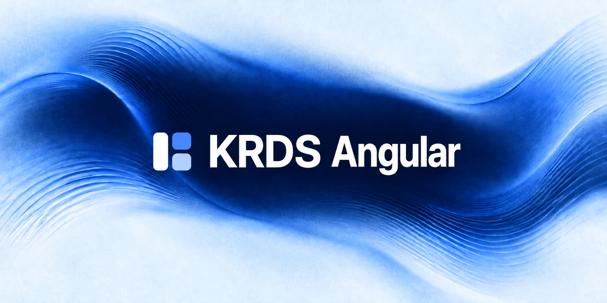

<p align="center">
  <a href="https://angular.krds.initializer.org/">
    
  </a>
</p>

<div align="center">

[](https://github.com/Initializer-org/krds-angular/actions/workflows/ci.yml)
[](https://angular.dev/)
[](https://github.com/KRDS-uiux/krds-uiux)
[](https://opensource.org/licenses/MIT)

</div>

<hr />
<div align="center">

<a href="https://angular.krds.initializer.org/">문서</a>
<span>&nbsp;&nbsp;•&nbsp;&nbsp;</span>
<a href="https://angular.krds.initializer.org/guide/getting-started">시작하기</a>
<span>&nbsp;&nbsp;•&nbsp;&nbsp;</span>
<a href="https://angular.krds.initializer.org/components/">컴포넌트</a>
<span>&nbsp;&nbsp;•&nbsp;&nbsp;</span>
<a href="https://www.npmjs.com/package/@krds.ui/angular">npm: @krds.ui/angular</a>

</div>
<hr />

## KRDS Angular: 대한민국 정부 디자인 시스템을 Angular로

**KRDS Angular의 npm 패키지는 [`@krds.ui/angular`](https://www.npmjs.com/package/@krds.ui/angular)입니다.** [Initializer Team](https://github.com/Initializer-org)이 유지보수하는 커뮤니티 라이브러리이며, 정부가 배포하는 공식 패키지와 별도로 배포됩니다.

Angular 프로젝트에서 민원 신청, 본인 인증, 처리 현황 같은 공공서비스 화면을 [KRDS(대한민국 정부 디자인 시스템)](https://www.krds.go.kr/html/site/index.html) 기준으로 구성할 수 있습니다. 폼·내비게이션·레이아웃을 조합하고, 기존 Angular 폼에 KRDS의 스타일과 키보드 동작을 적용하세요. 기본 입력 요소를 사용하므로 `ngModel`과 reactive forms의 데이터 연결·유효성 검사를 함께 쓸 수 있습니다.

- **KRDS 원본 그대로.** KRDS 원본 v1.1.0의 마크업·클래스·키보드 동작을 따르고, [KRDS Vue](https://github.com/Initializer-org/krds-vue)와 같은 스타일을 씁니다. [공식 컴포넌트 목록](https://www.krds.go.kr/html/site/component/component_summary.html)의 분류를 모두 옮겼습니다(스플래시 스크린은 각 플랫폼의 기본 기능 영역이라 제외).
- **접근성 자동 검사.** 모든 컴포넌트 테스트와 문서 예제가 실제 브라우저에서 axe-core 접근성 검사를 실행하고, 위반이 있으면 CI가 실패합니다. 고대비 모드를 지원합니다.
- **Angular 방식 그대로.** standalone 컴포넌트·디렉티브와 signal 입력으로 만들었고 zoneless로 동작합니다. 폼은 기본 입력 요소에 디렉티브를 붙이는 방식이라 `[(ngModel)]`, reactive forms, Signal Forms가 그대로 동작합니다.

> 초기 개발 단계입니다. npm의 [`@krds.ui/angular`](https://www.npmjs.com/package/@krds.ui/angular) 패키지로 설치할 수 있습니다.

## 빠른 시작

```bash
npm install @krds.ui/angular
```

pnpm을 쓰면 `pnpm add @krds.ui/angular`로 설치합니다. `Initializer-org/krds-angular`는 GitHub 저장소 이름이며, 설치와 import에는 `@krds.ui/angular`를 사용합니다. [패키지 이름과 원본과의 관계](https://angular.krds.initializer.org/guide/faq#package-names)를 참고하세요.

`angular.json`의 `styles`에 스타일시트를 추가합니다.

```json
"styles": ["@krds.ui/angular/style.css"]
```

```ts
import { Component } from '@angular/core'
import { KrdsButton } from '@krds.ui/angular'

@Component({
  selector: 'app-root',
  imports: [KrdsButton],
  template: `<button krdsButton variant="secondary" size="large">확인</button>`
})
export class App {}
```

Angular 20·21·22를 지원합니다(Signal Forms는 Angular 21부터). 번들 예산, 작성 방식, 폼, 고대비 모드는 [시작하기](https://angular.krds.initializer.org/guide/getting-started)를 참고하세요.

## 접근성

라이브러리 차원의 자동 검사는 KWCAG/WCAG 적합성 평가를 대체하지 않습니다. 서비스 전체의 접근성 준수는 사용처에서 별도로 검증해야 합니다.

## 기여하기

**버그와 기능 요청**은 [이슈](https://github.com/Initializer-org/krds-angular/issues)로 남겨 주세요. 큰 변경은 이슈에서 먼저 논의해 주세요.

```bash
pnpm install
pnpm test     # 실제 브라우저(Chromium)에서 단위 테스트와 axe-core 접근성 검사 (처음 한 번 pnpm exec playwright install chromium)
pnpm build    # dist/krds-angular에 패키지 생성
pnpm lint
pnpm format
pnpm docs:dev   # 문서 사이트(VitePress) 개발 서버, 예제는 docs/components/demos/*.ts
pnpm docs:check # 문서 예제 템플릿 타입 검사 (ngc)
pnpm docs:build && pnpm docs:test  # 문서 빌드 후 모든 페이지의 예제 렌더링·axe-core 검사
```

## 라이선스

MIT © [Initializer Team](https://github.com/Initializer-org)
